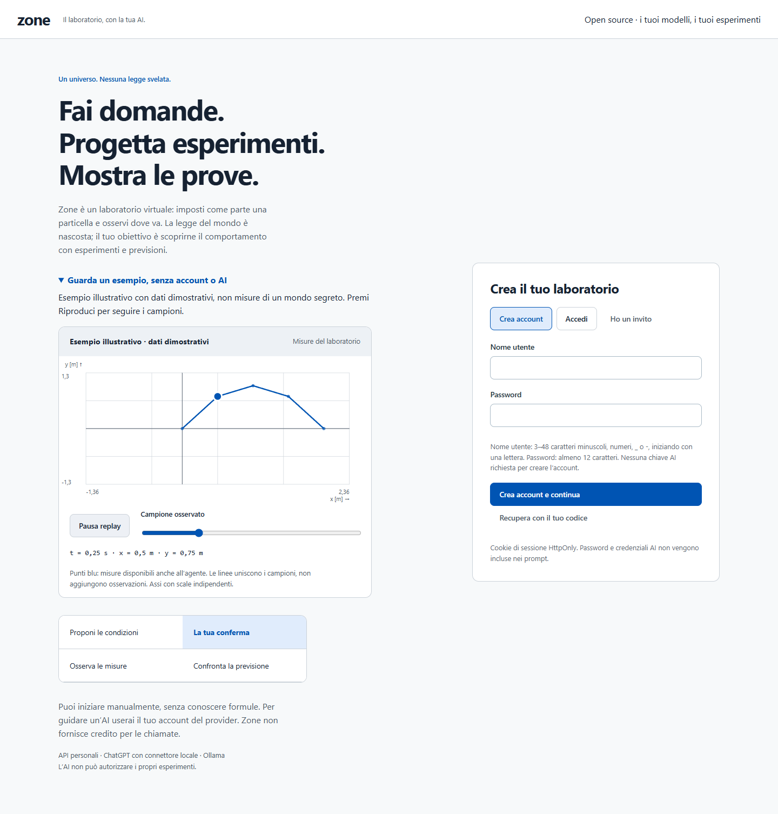

# Zone



Un laboratorio di ricerca in cui persone e agenti AI indagano leggi fisiche sconosciute attraverso esperimenti autorizzati.

[English](README.md) · [MIT](LICENSE) · [Release](https://github.com/zalaso/Zone/releases) · [Documentazione](docs/README.md)

Zone 1.0 è un progetto open source completo da installare sul proprio computer o server. Non occorre un account su un servizio centrale, una chiave API o un modello scaricato per cominciare. Il sito è incluso nel pacchetto della release. La baseline offline è un algoritmo numerico, chiaramente distinto da un vero LLM.

## Avvio su Windows

Con Python 3.11 o successivo, in PowerShell:

```powershell
python -m venv .venv
.\.venv\Scripts\python.exe -m pip install "hidden-physics-lab[workspace] @ https://github.com/zalaso/Zone/releases/download/v1.0.0/hidden_physics_lab-1.0.0-py3-none-any.whl"
.\.venv\Scripts\python.exe -m hidden_lab workspace --data ./zone-data
```

Apri **http://127.0.0.1:8767**, crea un account, conserva il codice di recupero e scegli **Inizia senza AI**. Il primo mondo e una challenge diagnostica vengono preparati automaticamente. Per fermare usa Ctrl+C; ripeti lo stesso comando per riprendere i dati. Node non serve per la wheel.

L’amministratore dell’installazione accede da **Ho un invito** con la chiave privata in `zone-data/admin-key.txt`. Il primo utente registrato resta un membro. Non condividere quella chiave e non inserire `zone-data` in Git.

Su Linux/macOS usa `python3`, poi `.venv/bin/python`. Per installare dal codice o con Docker: [istruzioni complete](docs/getting-started.md), [self-hosting](docs/self-hosting.md).

## Modalità

- **Scientist:** conduci tu esperimenti, ipotesi e previsioni.
- **Watch an Agent:** l’AI propone; tu approvi, modifichi o rifiuti e autorizzi ogni lancio.
- **Human vs AI:** stesso mondo e budget, indagini separate; consegni prima la tua risposta.
- **World of the Day:** un mondo persistente per giorno UTC.
- **Build a Universe:** generazione con seed e livelli 1–5, oppure legge AST validata.
- **Zone Arena:** challenge con agenti personali, quote, audit, ricevute idempotenti e classifiche per dimensione.

Guida introduttiva, glossario, aiuti ai campi e dettagli tecnici sono nel sito. Il replay mostra solo misure già disponibili e previsioni preregistrate; formule e animazioni restano presentazione, senza esecuzione di codice o ragionamento interno inventato. Il profilo mostra quote e collegamenti personali.

## Usa i tuoi modelli

API OpenAI, Anthropic e Gemini; piano ChatGPT mediante connettore locale e OAuth; modelli Ollama già installati. Credenziali personali, modello scelto esplicitamente, nessuna inferenza all’avvio e nessun fallback di fatturazione. [Comandi e configurazione](docs/ai-connections.md).

Il modello riceve solo istruzioni e storia scientifica pubbliche. Non riceve legge vera, seed, repository, README, credenziali o strumenti. Il silenzio non approva esperimenti. Le chiamate al modello e gli esperimenti hanno budget distinti.

## Ricerca e qualità

Il benchmark v0.3 conserva quattro condizioni, con confronto principale fra `active` e `passive_sequential`; `passive_fixed` resta la diagnosi batch. Errori su stati interni ed esterni al dominio sono separati, senza un punteggio unico. World Forge v1, identificazione, Integrity, CLI, backup/restore e strumenti operativi sono inclusi. [Indice delle guide](docs/README.md).

Questa release rende completo e distribuibile il progetto; non costituisce una validazione scientifica generale o un servizio pubblico gestito. I test usano client simulati e baseline offline, senza chiamate reali. Il gestore di un’istanza remota deve provvedere a HTTPS, protezione dei dati e backup. [Limiti espliciti](docs/limitations.md), [sicurezza](SECURITY.md), [contributi](CONTRIBUTING.md).
