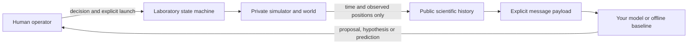

# Zone

**A research laboratory where people and AI agents discover unfamiliar physical laws through controlled experiments.**

[](https://github.com/zalaso/Zone/actions/workflows/ci.yml) · [MIT](LICENSE) · [Releases](https://github.com/zalaso/Zone/releases) · [Italiano](README.it.md)

Set a particle's initial conditions, authorize a launch and observe its motion. Propose a hypothesis, preregister numerical predictions and test them against new measurements. The law stays private. The AI proposes; **a person authorizes every experiment**.

Zone 1.1 is a complete, self-hosted application and research toolkit. Run it on your own computer or server; no central Zone account, paid service or provider credential is required to start. The default agent is an explicitly labelled numerical offline baseline, not an LLM. The web interface includes English guided onboarding, glossary, interactive trajectories and mathematical notation.


[Watch the 42-second introduction](https://github.com/zalaso/Zone/releases/download/v1.1.0/zone-introduction-en.mp4) · [Interface and installation checks](docs/english-experience.md)

*Actual offline application. The landing-page trajectory is labelled demonstration data, not evidence from a hidden evaluation world.*

## Start in minutes

Python 3.11 or later. The release wheel includes the compiled website: **Node is not required**.

### Windows / PowerShell

```powershell
python -m venv .venv
.\.venv\Scripts\python.exe -m pip install "hidden-physics-lab[workspace] @ https://github.com/zalaso/Zone/releases/download/v1.1.0/hidden_physics_lab-1.1.0-py3-none-any.whl"
.\.venv\Scripts\python.exe -m hidden_lab workspace --data ./zone-data
```

### Linux / macOS

```sh
python3 -m venv .venv
.venv/bin/python -m pip install 'hidden-physics-lab[workspace] @ https://github.com/zalaso/Zone/releases/download/v1.1.0/hidden_physics_lab-1.1.0-py3-none-any.whl'
.venv/bin/python -m hidden_lab workspace --data ./zone-data
```

Open **http://127.0.0.1:8767**, create an account, save the recovery code and choose **Start without AI**. A world and diagnostic Arena challenge are initialized automatically. Stop with Ctrl+C; start the same command to resume. Your data remains in the private `zone-data` folder.

The installation owner can sign in through **I have an invite** using `zone-data/admin-key.txt`. The first registrant never gets administrator privileges. Protect this file; it is not shown by the site or sent to a model. [Installation, owner recovery and troubleshooting](docs/getting-started.md).

Prefer Docker? Clone the repository and run `docker compose up --build`; open the same loopback URL. Data stays in a named volume. [Docker and HTTPS self-hosting](docs/self-hosting.md).

## What you can do

| Mode | Your role | Outcome |
| --- | --- | --- |
| **Scientist** | Choose experiments and write hypotheses yourself | A recorded investigation, preregistered verification and final probe scores |
| **Watch an Agent** | Guide your own AI, approve/modify/reject its proposals | Public messages, evidence, limits and final conclusions |
| **Human vs AI** | Complete your investigation first, then supervise the agent | Same world and experiment budget; separate histories and scores |
| **World of the Day** | Explore a persistent daily world | A manual investigation without selecting a case |
| **Build a Universe** | Generate a level 1–5 world, or author a restricted AST law | Server validation before registration; no arbitrary code execution |
| **Zone Arena** | Bring an agent to a shared challenge | Idempotent trials, quotas, audit and per-dimension leaderboards after closure |

The UI explains each phase and setting. Watch public measurements with play/pause and sample controls, compare a dashed preregistered prediction, and revisit any point in the event history. No future measurement is shown when scrubbing backward. Waiting animations represent waiting, not invented progress or private chain of thought. Reduced-motion preferences are respected.

## Bring your own AI

- **OpenAI / Anthropic / Gemini APIs:** use a personal API key, either encrypted on your server or retained in a local outbound connector.
- **ChatGPT plan:** authorize through the official local/open-source OAuth flow; the connector keeps tokens on your computer. Eligibility and provider preview limitations apply.
- **Ollama:** use a model already installed locally. Zone does not download models or expose Ollama to the Internet.

Install the optional provider extra, choose an explicit model and configure **AI connections**. There is no costly default model, no inference at startup and no automatic billing fallback. Real requests consume your own provider allowance. [Exact setup and commands](docs/ai-connections.md).

## Research toolkit

**Benchmark v0.3** preserves four conditions: `prior_only`, `passive_fixed` (batch diagnostic), `passive_sequential` and `active`. The main comparison is active vs sequential passive. Interpolation and extrapolation metrics stay separate, as do raw observations, model calls, invalid replies and stop states. Paired comparisons reject mismatched configuration; no combined score is manufactured. [Benchmark protocol](docs/benchmark.md).

**World Forge v1** provides seeded generation, safe AST interpretation, RK4 simulation and a bounded validation pipeline for levels 1–5. Candidate laws can be compared empirically on a private grid; this is not a general symbolic equation prover. [World Forge](docs/world-forge.md), [identification](docs/identification.md), [Integrity](docs/integrity.md).

```sh
python -m hidden_lab --help
python -m hidden_lab ops demo --out benchmark_data/my-first-demo
```

The full offline demo runs Arena, all four benchmark conditions, aggregation/report and backup/restore. It requires the `workspace` or `backend` extra and a new output directory. CLI `demo`, `shell`, `investigate`, `forge`, `identify`, `benchmark`, `arena`, `integrity`, `identity` and `ops` remain available. [Documentation index](docs/README.md).

## Public/private boundary



Models never receive the README, source code, private law, seed, answers, credentials or tool access. Experiment approval, exploration/verification and execution are distinct. A network error never authorizes repetition of a completed experiment. In the authenticated site, “public history” means available to the scientific agent; the replay is restricted to its owner and authorized staff.

## Status and limits

The software release is installable and tested offline. This repository does not promise a managed public service, competitive model attestation or scientific validation across real models. A previous small real-model pilot establishes protocol feasibility, not general discovery ability. Current provider adapters are also tested with simulated transports; no real inference runs in CI. Exact LLM response reproducibility is not promised.

SQLite and a trusted single-process operator are the supported deployment scope. A remote operator is responsible for HTTPS, backups, retention and user support. The AST and world-validation checks are deliberately bounded. [Limitations](docs/limitations.md), [data handling](docs/privacy.md), [security](SECURITY.md).

## Develop and contribute

[CONTRIBUTING](CONTRIBUTING.md) covers setup, tests and release builds. CI exercises Python on Linux/Windows, frontend tests, package boundaries, a clean installed wheel, Docker persistence and offline browser flows. [Architecture](docs/architecture.md) and [operator protocol](docs/apparatus-protocol.md) explain the implementation; never feed those documents to evaluated models.

[Report a bug](https://github.com/zalaso/Zone/issues/new/choose) · [Discuss an idea](https://github.com/zalaso/Zone/discussions) · [Report security privately](SECURITY.md)

Licensed under [MIT](LICENSE). Bundled frontend notices are in [THIRD_PARTY_NOTICES](THIRD_PARTY_NOTICES.md). See [CHANGELOG](CHANGELOG.md) and [release verification](docs/release-checklist.md).
